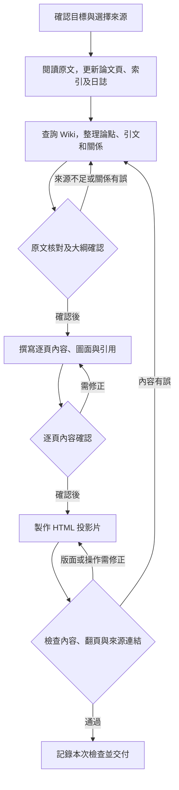

# 論文 LLM Wiki 與教學簡報

## 1. LLM Wiki 主題

**AI 方法、應用與驗證。** 這個 Wiki 用於文獻回顧，目前收錄五篇論文，涵蓋 LLM 欺騙偵測、搜尋體驗評估、後設分析、多代理強化學習與聯邦學習。每篇筆記記錄研究問題、方法、結果、限制及原文位置，供後續比較和查證。

## 2. LLM Wiki 成果

- [論文索引](wiki/index.md)連到五篇論文筆記，按原始閱讀順序排列。
- [工作日誌](wiki/log.md)記錄匯入與檢查。[AGENTS.md](AGENTS.md)說明原始資料、筆記、索引和日誌的維護方式。
- 論文筆記附 arXiv 來源。本機原始 PDF 保存在 `raw/`。

## 3. 教學 HTML 簡報

[線上播放《LLM 的運用方式》](https://mikeaul.github.io/llm-wiki-notes/asset/llm-use-cases.html)，共六頁。從 LLM 在工作中負責的任務講起，用搜尋體驗評估與後設分析兩個案例，帶讀者辨認模型輸入、輸出和查證方式。最後用一個有多個時間點的研究結果示範如何核對擷取內容。[HTML 原始檔](asset/llm-use-cases.html)

| 簡報 | Wiki 依據 |
| --- | --- |
| 第 3 頁，搜尋體驗評估 | [Dual-Tier Sentiment Framework](wiki/papers/ding-2026-dual-tier-sentiment.md)，原文摘要與圖 1。 |
| 第 4、6 頁，後設分析和應用示例 | [MetaRigor](wiki/papers/xie-2026-metarigor.md)，原文表 2、表 20，以及結果識別與來源綁定設計。第 6 頁是教學示例。 |

## 4. Loop / Graph 流程

每加入一篇論文，就重跑一次匯入與索引檢查。做簡報時，論點或箭頭有問題就回查 Wiki 和原文，修正後再確認大綱。逐頁確認保留給內容與引用，HTML 階段才檢查排版和操作。這樣可以在排版前處理會改動多頁的內容問題。

## 5. 實際執行與檢查紀錄

**2026-11-23，搜尋體驗案例的來源核對。** 從簡報第 3 頁回到 Dual-Tier Wiki 筆記，再查原文圖 1。原標題「先篩查，再診斷」暗示順序執行。圖 1 描述兩路並行，並以「整頁體驗未退化」與「局部使用阻力有改善」共同判定是否符合上線條件。

已修正第 3 頁標題、補上共同判定條件，並在 Wiki 筆記記下原文圖 1 的定位。複查時保留整體篩查的 PR-AUC 與局部診斷的 F1 各自所屬的任務。[原文圖 1](https://arxiv.org/pdf/2611.27899#page=2)

**驗收結果。** 五篇論文皆有索引、匯入紀錄及原文定位。Chrome 在 1366 × 768 與 390 × 844 尺寸均能顯示全部六頁，上一頁、下一頁、方向鍵及首末頁切換通過檢查。[工作日誌](wiki/log.md)

## 6. 反思與調整

這次最容易出錯的是**把研究內容轉成 Graph 關係**。把兩個功能排成左右順序，很容易讓讀者以為第一步會觸發第二步。下次在確認大綱前，就為每條箭頭寫下關係詞和原文定位，例如「並行評估」「兩者皆須成立」。同一個節點也會核對指標對應的任務和比較條件。若原文只支持並行關係，圖就保留兩路並在共同條件處匯合。
