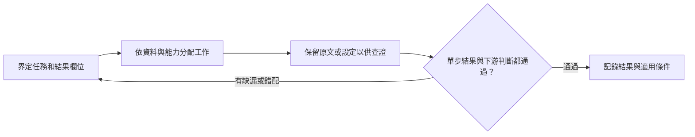

# AI 工作流程的設計與驗證

**研究問題**　當模型參與一個需要做判斷的流程時，怎麼定義它要完成的任務、分配不同元件的工作，並驗證結果足以支援下一步？

五篇論文分別從部署評估、文獻分析、模型偵測、代理策略和聯邦訓練切入。Dual-Tier 和 MetaRigor 示範 LLM 如何嵌入流程，Geometry of Lies 檢驗 LLM 內部訊號是否足以支撐偵測，SLICR 與 HNFL 則補上強化學習和聯邦學習的設計案例。以下以共同的設計問題串接各篇證據。

## 1. 定義要做的判斷

SLICR 把行為目標寫成形式規範，用策略邏輯（Strategy Logic）表達對其他代理策略的量化，再用線性時序邏輯（LTL）描述行為目標和約束。MetaRigor 用任務契約（Task Contracts）區分哪些事實能使用、哪種決策交給模型，以及哪些結果可由程式核驗。兩者分別將規範用於**引導策略學習**與**約束證據處理**。對 Wiki 工作流的啟示是，在模型開始擷取前就定義比較組、研究族群、結局、時間點及來源位置。 [SLICR，PDF 第 3–8 頁，§3–5](../papers/rafieioskouie-2026-slicr.md) · [MetaRigor，PDF 第 5–8 頁](../papers/xie-2026-metarigor.md)

## 2. 按資料與任務分工

Dual-Tier 的兩層系統並行評估同一個搜尋實驗。遙測資料用於篩查整頁體驗是否退化，渲染後的頁面則用於診斷局部使用阻力。從使用者體驗角度，兩項條件都滿足才符合上線判準。HNFL 處理的是另一種分工問題。ANN 與 SNN 客戶端共同訓練，系統區分可共享參數與模型專用參數。兩者的設計共通點是先界定**哪些結果或狀態需要共享**，以及**哪些處理須保留在各自的元件中**。對 Wiki 流程而言，模型可擷取帶有脈絡的候選結果，程式可處理重複項、計算及定位檢查。這個分工是從案例延伸的設計選擇。 [Dual-Tier，PDF 第 1–2 頁，圖 1](../papers/ding-2026-dual-tier-sentiment.md) · [HNFL，PDF 第 2–4 頁](../papers/nguyen-2026-hnfl.md) · [MetaRigor，PDF 第 5–8 頁](../papers/xie-2026-metarigor.md)

## 3. 從測試分數回到實際決策

Geometry of Lies 中，Llama 的同層監督式探針在 HP-KR 上有 0.936 AUROC，按基準門檻卻沒有標出 139 個欺騙案例中的任何一個。這說明排序分數和固定門檻的檢出結果回答不同問題。MetaRigor 也把單步擷取與下游完整流程分開評估，並追蹤結局或時間點配錯如何流入統計與稿件。兩篇都提醒我們，檢查要涵蓋**單步輸出是否正確**與**下游是否作出合適的決策**。 [Geometry of Lies，PDF 第 6、11–12 頁，§4.1、§7](../papers/al-zami-2026-geometry-of-lies.md) · [MetaRigor，PDF 第 9、24–26 頁，表 2、表 20、附錄 G.3](../papers/xie-2026-metarigor.md)

## 五篇論文的證據與適用條件

| 文獻 | 驗證了什麼 | 解讀時要保留的條件 |
| --- | --- | --- |
| [Geometry of Lies](../papers/al-zami-2026-geometry-of-lies.md) | 相同回答文字的 HP-KR 子集上，Llama 與 Mistral 的知識方向 AUROC 為 0.793 與 0.840，超過各自隨機方向的上界。（PDF 第 7、9 頁，§4.3、表 1） | 控制了回答措辭，提問仍不同。HP-KR 曾用於方法開發。（PDF 第 11–12 頁） |
| [SLICR](../papers/rafieioskouie-2026-slicr.md) | 在 IPPO 的 SMAC-HARD 3s_vs_3z 設定，對未見策略的勝率約為 80%，LIAM 約為 10%。（PDF 第 10 頁，圖 3i） | 結果對應特定地圖、預算和訓練方式。對手策略泛化和任務目標泛化需要分開驗證。 |
| [Dual-Tier](../papers/ding-2026-dual-tier-sentiment.md) | 整體篩查 PR-AUC 提升 9.8%，局部診斷 F1 改善超過 6.5%。（PDF 第 1 頁，摘要） | 兩個指標對應不同任務。局部診斷採非同步批次評估，受渲染與推論成本影響。（PDF 第 7 頁） |
| [MetaRigor](../papers/xie-2026-metarigor.md) | 完整資料擷取 F1 為 86.29%，在七案例下游評估的整體 F1 為 77.01%，最高比較基準為 67.23%。（PDF 第 9、25 頁，表 2、表 20） | 單步與下游 F1 的評估範圍不同。七案例仍需在其他領域驗證。（PDF 第 11、24 頁） |
| [HNFL](../papers/nguyen-2026-hnfl.md) | CIFAR-10 的特定混合訓練設定，Poisson 輸入的 ANN ResNet 準確率由 56.60% 升至 73.45%。（PDF 第 4 頁） | 保留架構、編碼與客戶端配置。異質的 non-IID 資料仍待驗證，脈衝活動和實機能耗需分別衡量。（PDF 第 6 頁） |

五篇研究的任務、資料與指標各異。可以比較它們**如何界定任務、傳遞結果、處理失敗**；表中數字應各自在原研究的比較條件下解讀。

## 綜合推論與 Wiki 工作流

**可用於文獻回顧的結論**　AI 工作流的可驗證性取決於三個環節：任務開始前明確界定輸出，執行時保留模型與程式各自處理的資料和規則，交付前檢查輸出與後續決策。應用到此 Wiki 時，每項投影片主張需能連回筆記與原文頁碼。若比對時發現指標、比較基準或適用條件錯配，先回到主張及來源修正，再重新製作對應頁面。

**待驗證問題**　若在整理投影片大綱時就檢查「主張、評估條件、原文定位」，能否比成品階段才核對更早發現錯配？可比較兩種流程各自發現的錯誤數、修正時間，以及有多少錯誤進入 HTML 成品。
